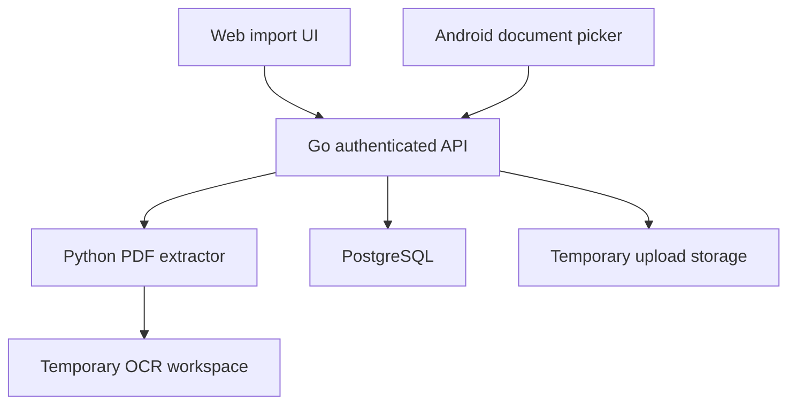

# Statement import — Phase 1 approval plan

Status: proposed; no application implementation authorized by this document.

## Decisions and scope

- Account management is the prerequisite: user-owned bank/card accounts, then import.
- No LLM, paid extraction API, ML categorizer, or currency conversion.
- Reject encrypted PDFs, unsupported formats, currency mismatch, and failed or unverifiable reconciliation.
- Keep transfers and repayments as ordinary debit/credit transactions.
- Delete uploaded PDFs after processing and Python temporary files before responding. Preview data expires after 24 hours.
- Keep existing Horizon calculations unchanged; fix their 50-row/credit aggregation behavior separately.
- One monorepo, one feature branch `feature/statement-import`, small commits by feature/component. No push or PR.

## Corpus findings (Phase 0 completion)

Inspected `test-statement/statement-test.pdf` locally without printing document content. It is an unencrypted five-page A4 PDF with a text layer, identifying Kotak Mahindra Bank, a savings account, and INDIAN RUPEE (INR). Transaction tables span the first two pages; a later summary supplies opening/closing balances. Other pages contain explanatory material.

Columns: sequence, date, description, cheque/reference, withdrawal (Dr.), deposit (Cr.), balance. Dates use `DD Mon YYYY`; amounts use a decimal point and comma grouping. Descriptions wrap across lines. Account/table headers repeat. Column positions shift across pages, requiring per-page header anchors. Running balances are present.

A read-only Poppler-layout/Decimal cross-check found 22 rows, zero running-balance failures, and an exact opening-plus-net-equals-closing match. This is preliminary evidence, not a test of the proposed parser. Only one bank/account layout is currently evidenced. There are no real scanned or credit-card examples in the supplied corpus.

First profile: `kotak_savings_v1.json`. No speculative profiles for other banks/cards. Their accounts can be created immediately, but their statements fail clearly until supported. Additional real samples extend this list.

## Architecture

Go owns account CRUD, authentication, upload validation/hash, profiles, row assembly, exact reconciliation, categories, drafts, dedupe, commit, and cleanup. Python only returns text/geometry/tables/OCR provenance. It has no database credentials or business logic. Multipart transfer avoids a shared document volume. Raw uploads and OCR files use bounded container tmpfs; PostgreSQL holds previews and committed records. Corpus files mount read-only only in the test runner.

Choose pdfplumber: MIT-licensed, supports word coordinates, font-size attributes and tables. Evaluate PyMuPDF as a possible future performance alternative, but do not add it: it is AGPL/commercial dual-licensed, and no measured bottleneck justifies another dependency. OCRmyPDF/Tesseract handle missing-text pages; OCR results are marked lower confidence and still require exact reconciliation. Pin compatible versions during implementation and record the resolved versions.

Sources: https://github.com/jsvine/pdfplumber ; https://pymupdf.readthedocs.io/en/latest/about.html ; https://ocrmypdf.readthedocs.io/en/stable/pdfsecurity.html

## Accounts and database migrations

Use golang-migrate pairs, initially `00038_financial_accounts.{up,down}.sql` and `00039_statement_imports.{up,down}.sql`; renumber only if another migration lands first.

`financial_accounts`: id, user_id, display_name, institution_name (free text), account_type (`bank_account`, `credit_card`), bank_account_subtype (`savings`, `current`, `other`, nullable), currency, optional country_code, optional last_four, archived_at, created_at, updated_at. Debit cards use their underlying bank account, avoiding a second ledger for the same money. No full PAN, CVV, PIN, credentials, or full account number is stored. Institution matching uses profile bank identity plus normalized user input; ask for explicit confirmation if it cannot be verified. Last-four mismatches fail. Missing/ambiguous identifiers require explicit account confirmation; last four alone never globally identifies an account.

Add nullable `account_id` to transactions; existing rows remain unassigned. Users can select an account in manual transaction forms. Archive accounts instead of destroying their history. Enforce owner-consistent account/batch relationships with composite constraints and owner-scoped queries.

`statement_import_batches`: UUID id, user_id, account_id, source_sha256, status, profile_id/version, currency, statement date bounds, opening/closing numeric balances, reconciliation status and safe reason code, OCR flag, revision, counts, created/updated/expires/committed timestamps, account-confirmed flag. Statuses: `processing`, `ready`, `failed`, `unsupported`, `committed`, `cancelled`, `expired`. Duplicates-only is a ready batch with zero new rows, not a parsing failure. Do not persist original filenames.

`statement_import_rows`: batch_id, ordinal, source page/row, immutable source fields (date/description/positive amount/type/reference/running balance), editable preview fields, category_id, inclusion flag, duplicate status, fingerprint and occurrence index, warning codes. Numeric amounts use the existing NUMERIC(12,2) representation; reject overflow or unsupported precision instead of rounding. Balances use a suitably wider signed NUMERIC. Do all parsing/reconciliation in exact scaled integer arithmetic, not float64; convert only at existing API boundaries.

Transactions gain `source` (manual/statement), nullable `import_batch_id`, `import_row_id`, `dedupe_hash`, and duplicate occurrence discriminator. Source fingerprints remain stable after description/category edits. Add unique constraints for import-row commitment and per-user/account fingerprint occurrence. Retain compact dedupe tombstones independently of removable transaction history so deleting a transaction does not silently enable its re-import.

`statement_import_dedupe`: user_id, account_id, dedupe_hash, occurrence_index, batch_id, import_row_id, nullable transaction_id, created_at; unique owner/account/hash/occurrence key. Preserve the fingerprint when its transaction is deleted. `statement_import_structures`: batch_id, extracted_structure JSONB, expires_at; purge on expiry/cancel.

`statement_category_rules`: user_id, normalized merchant key, category_id, timestamps. Learn only explicit category corrections, without recording amounts or full account identifiers. Fall back to existing default categories/Other. No ML.

Store unsupported extracted structure in a separate batch-linked JSONB record with the same 24-hour TTL. Supported batches retain only what preview needs. Expiry cleanup runs at startup and periodically in Go; API access enforces expiration even if cleanup is delayed. Committed source rows retain the import audit trail; expired/cancelled previews lose descriptions/structure. Failed batches retain safe reasons/counts only. Never retain passwords.

## API contracts

All client endpoints are under `/api/horizon`, use existing session auth and user scoping, return JSON, and set no-store. Unauthorized: 401. Missing or other-user resources: 404. Validation: 400/422. Errors extend the existing envelope: `{ "error": "Safe user message", "code": "CODE", "request_id": "..." }`; never include document values or library exceptions.

Account object: `{id, display_name, institution_name, account_type, bank_account_subtype, currency, country_code, last_four, archived_at}`.

| Method and path | Request | Success |
|---|---|---|
| GET `/accounts?include_archived=false` | None | 200 `{accounts: Account[]}` |
| POST `/accounts` | Editable Account fields, excluding id/archived_at | 201 Account |
| PUT `/accounts/{id}` | Editable Account fields | 200 Account; disallow identity/currency changes after imports, allow labels |
| POST `/accounts/{id}/archive` | `{}` | 200 Account |
| POST `/accounts/{id}/restore` | `{}` | 200 Account |
| POST `/statement-imports` | Multipart `file`, `account_id` | 201 BatchPreview for a reconciled draft; parsing errors below include safe `batch_id` when created |
| GET `/statement-imports/{id}` | None | 200 BatchSummary, including revision/counts/status/reconciliation |
| GET `/statement-imports/{id}/rows?page=1&page_size=100` | None | 200 `{rows, page, page_size, total}` |
| PATCH `/statement-imports/{id}/rows` | `{revision, account_confirmed?, changes:[{id,date?,description?,amount?,type?,category_id?,included?}]}` | 200 BatchSummary with incremented revision; validate the complete source set atomically |
| POST `/statement-imports/{id}/commit` | `{revision}` | 200 `{batch_id,status:"committed",imported,duplicates_skipped,excluded}`; identical response on retry |
| DELETE `/statement-imports/{id}` | None | 204 cancel and purge draft content; committed batch returns 409 |
| GET `/statement-imports/{id}/structure?page=1` | None | 200 `{page_count,page:{width,height,words,tables}}` only for unsupported, unexpired owner batch |

BatchPreview: BatchSummary plus first row page. BatchSummary: `{id,account_id,status,revision,profile_id,currency,expires_at,ocr_used,account_confirmation_required,reconciliation:{status,code},counts:{parsed,new,duplicates,excluded}}`. Row: `{id,date,description,amount:"123.45",type,category_id,included,duplicate_status,reconciliation_status,warnings}`. Dates are ISO calendar dates. Preserve source dates for dedupe; convert to the user's timezone consistently when populating the existing timestamp column.

Relevant errors: 413 `FILE_TOO_LARGE`; 415 `NOT_PDF`; 422 `ENCRYPTED_PDF_UNSUPPORTED`, `UNSUPPORTED_BANK`, `CURRENCY_MISMATCH`, `ACCOUNT_MISMATCH`, `RECONCILIATION_FAILED`, `BALANCES_UNAVAILABLE`, `INVALID_ROW`, `AMBIGUOUS_DUPLICATE`; 409 `STALE_REVISION`, `ACCOUNT_ARCHIVED`, `BATCH_NOT_READY`, `ALREADY_IMPORTED`; 410 `BATCH_EXPIRED`; 429 `EXTRACTOR_BUSY`; 502 `EXTRACTION_FAILED`; 504 `EXTRACTION_TIMEOUT`. Network interruption is handled by retrying the upload: reuse an existing ready batch for the same user/account/file hash, or return `ALREADY_IMPORTED` with the existing batch ID. Expired/cancelled/failed batches can be retried. Never return another user's batch.

Existing transaction create/update/bulk DTOs add optional `account_id` with owner validation; list responses include it. Existing endpoints and clients remain compatible. Import commit is separate from the old bulk endpoint so the client cannot bypass reconciliation by committing a draft through bulk.

Internal Python: `POST /extract` multipart PDF only; 200 `{page_count,ocr_used,pages:[{number,width,height,text_layer_exists,ocr_used,words:[{text,x0,x1,top,bottom,size}],tables:[{bbox,rows}]}]}`. `text_layer_exists` describes the original page, before OCR. `/healthz` returns 200 `{status:"ok"}`; `/metrics` exposes counters/histograms. Internal errors use safe codes for invalid/encrypted PDFs, limits, OCR failure, timeout, and capacity. No password field in v1.

## Profiles, parsing, reconciliation and dedupe

Profiles are versioned JSON with: id/version, institution/account types, all/any/negative detection markers, header anchors, per-page column boundaries relative to anchors, y tolerance, date formats, decimal/grouping separators (including Indian grouping), currency markers, debit/credit convention, continuation rules, ignored rows/regions, account identifier locations, statement period and opening/closing balance selectors, ledger equation and row direction. Only declarative whitelisted operations; no evaluated scripts. Design local user mappings as owner-scoped instances of this schema, but no mapping UI in v1.

Pipeline: extract -> detect profile -> assemble rows by y/x -> join wrapped descriptions/references -> normalize -> reconcile -> categorize -> detect duplicates -> preview -> commit. A normalized row interface separates assembly from downstream processing, allowing CSV/OFX/QIF/MT940/CAMT.053 readers later.

Only high-specificity bank/header markers select a profile; bank names inside transaction descriptions do not. Reject ambiguous profile matches. Reconcile every source row before dedupe/exclusion; verify running balances and final opening + signed net = closing. Credit-card profiles will need debt-balance equations supported by real card fixtures. Missing balances fail, with no override.

Fingerprint includes user/account identity, calendar date, direction, exact amount, normalized source description, running balance when available, plus stable bank reference when suitable. Repeated identical legitimate rows use occurrence-aware matching. If overlap cannot distinguish a duplicate from a genuine repeat, block with `AMBIGUOUS_DUPLICATE`, never silently drop it. Manual matches are warnings, not automatic skips. Category/description edits preserve source fingerprint. Financial edits revalidate the complete source ledger. Removing a preview row sets `included=false`; it does not erase the immutable source row used for reconciliation. Duplicates are excluded from commit, not from source validation.

Commit locks batch and account, checks revision/expiry/ownership/reconciliation, recomputes duplicates, inserts selected rows and dedupe records, and marks the batch committed in one PostgreSQL transaction. Serialize account-level commits to handle simultaneous overlapping imports. Retried commits return recorded counts. Historical manual rows remain unchanged.

## UI

First add an Accounts area within Horizon on web/Android, using current design-system components and navigation. Support create/edit/archive, bank/card type, user-entered institution and label, profile currency, optional country and last four. Avoid collecting unnecessary sensitive fields.

Then update the web Import Statement entry and add Android's corresponding entry: account selection -> PDF picker -> upload progress -> extraction state -> paginated preview -> confirm -> result counts. Android uses OpenDocument with no new storage permissions. Reuse existing authenticated clients, Koin/domain/data boundaries, StateFlow, themes and accessible components. Password-protected files show an unsupported error, not a password prompt. Do not expose raw JSON by default.

Preview includes date, description, amount/type, category, duplicate flag, reconciliation and OCR warning; supports inline changes and exclusion. Disable confirm for failed/expired/ambiguous batches. Duplicates-only shows zero new transactions and a clear completed/no-op result. No transfer classification or multi-currency aggregation changes.

## Compose, limits, cleanup and observability

Add a shared extractor service for dev/prod with `python:3.12-slim` conventions, non-root, read-only root filesystem, tmpfs scratch, dropped capabilities, bounded memory/CPU/processes and no host ports. Attach only to a dedicated `internal: true` extraction network; Go and Prometheus also join it. Python cannot reach PostgreSQL. No Cloudflare route. Build OCR dependencies into the image; no network fetch during extraction.

Initial configurable limits: 10 MiB upload, 100 pages, 100,000 words, 10,000 rows, 32 MiB extractor response, one active extraction per worker, 120-second extractor deadline, 150-second Go extraction client deadline, 180-second import-route/client deadline. A Python subprocess isolates each extraction/OCR task and is killed on timeout; cleanup in finally and tmpfs on container exit. Limit OCR pixel count and subprocess threads. All values are proposals to validate against the corpus, not measured capacities.

Keep ordinary Go routes/Android requests at 15 seconds; set longer limits only for import. Upload remains a bounded synchronous operation initially, avoiding a durable raw-PDF queue. Interrupted processing is marked failed/retryable on restart; startup removes stale local temporary files. Update dev backend healthcheck and make both Go services depend on healthy extractor. Test-only override adds isolated PostgreSQL, test configuration and read-only corpus mount; never run the current personal dev-seed against the test DB.

Add env examples for extractor URL, limits, timeouts, preview TTL and test corpus directory. No secrets in code. Python logs JSON metadata matching slog fields (`time`, `level`, `msg`, request/trace IDs, status, duration), no filenames, descriptions, balances, amounts or account identifiers. Carry trace/request IDs internally. Prometheus metrics cover extraction counts/duration/failures/inflight and Go parse/reconciliation/commit outcomes, with bounded labels only. Add scrape config, dashboard panels and tested failure/latency alerts; Alloy discovers extractor container logs automatically.

## Exact intended file inventory

Paths below are relative to this single repository. Braces denote the exact listed filenames, not an open-ended directory change.

New Go:
- `go-backend/migrations/00038_financial_accounts.{up,down}.sql`
- `go-backend/migrations/00039_statement_imports.{up,down}.sql`
- `go-backend/internal/horizon/{accounts.go,accounts_test.go}`
- `go-backend/internal/horizon/query/accounts.sql` and generated `accounts.sql.go`
- `go-backend/internal/statementimport/{handler.go,service.go,repository.go,types.go,extractor.go,profile.go,assemble.go,normalize.go,reconcile.go,dedupe.go,categorize.go,cleanup.go,metrics.go}`
- `go-backend/internal/statementimport/{handler_test.go,service_test.go,extractor_test.go,profile_test.go,assemble_test.go,normalize_test.go,reconcile_test.go,dedupe_test.go,categorize_test.go,cleanup_test.go,integration_test.go}`
- `go-backend/internal/statementimport/profiles/{embed.go,kotak_savings_v1.json}`
- `go-backend/internal/statementimport/query/imports.sql` and generated `{imports.sql.go,models.go,db.go}`
- `go-backend/internal/statementimport/testdata/kotak_savings_v1.json` (synthetic geometry/expected rows)

Changed Go:
- `go-backend/cmd/api/{main.go,router.go,router_test.go}`
- `go-backend/internal/horizon/{routes.go,transactions.go,transactions_test.go,ownership_test.go}`
- `go-backend/internal/horizon/query/{transactions.sql,transactions.sql.go,models.go}`
- `go-backend/sqlc.yaml`, `go-backend/internal/apidoc/spec.go`, generated `go-backend/docs/{docs.go,swagger.json,swagger.yaml}`
- `go-backend/{Dockerfile,README.md}`; `go.mod`/`go.sum` only if a justified dependency is required (JSON profiles and scaled integers should need none).

New Python: `statement-extractor/{Dockerfile,requirements.txt,server.py,extract.py,metrics.py,test_server.py,test_extract.py,README.md}`.

New shared fixtures/tools: `tests/statement-import/fixtures/{kotak_savings_sanitized.pdf,kotak_savings_scanned.pdf,encrypted_synthetic.pdf,malformed.pdf,expected.json}`, `scripts/{sanitize-statement-fixtures.py,run-statement-corpus.sh,statement-corpus-runner.py}`. Fixtures remove names, addresses, account/reference identifiers and identifying descriptions; substitute synthetic monetary data and regenerate consistent balances. Rasterized scanned fixture derives only from sanitized content. Inspect rendered output and extracted metadata/text for leaks before committing.

New web:
- `life-tracker-frontend/app/financial-horizon/components/{AccountsTab.tsx,AccountDialog.tsx,StatementPreview.tsx}`
- `life-tracker-frontend/app/financial-horizon/{statement-import.ts,statement-import.test.mjs}`
- `life-tracker-frontend/e2e/{statement-import.spec.ts,accounts.spec.ts}`

Changed web:
- `life-tracker-frontend/app/financial-horizon/{actions.ts,financial-horizon-client.tsx,extract-statement.ts,transaction-dialog.tsx}`
- `life-tracker-frontend/app/financial-horizon/components/{StatementUploadDialog.tsx,TransactionsTab.tsx,TabNavigation.tsx,QuickActionDropdown.tsx}`
- `life-tracker-frontend/app/dashboard/financial-horizon-card.tsx` (optional account field only)

Android paths use prefix `pulse-android/` and standard package `dev/abhishekan/pulse`:
- New `core/domain/src/main/kotlin/dev/abhishekan/pulse/core/domain/model/{FinancialAccount.kt,StatementImport.kt}`; `repository/StatementImportRepository.kt`; `usecase/{ManageFinancialAccounts.kt,ImportStatement.kt}` under the same domain package.
- New `core/network/src/main/kotlin/dev/abhishekan/pulse/core/network/StatementImportApi.kt` and `dto/StatementImportDtos.kt`.
- New `core/data/src/main/kotlin/dev/abhishekan/pulse/core/data/{PulseStatementImportRepository.kt,StatementImportMapping.kt,StatementFiles.kt}`.
- New `feature/horizon/src/main/kotlin/dev/abhishekan/pulse/feature/horizon/{AccountsScreen.kt,AccountEditor.kt,AccountsViewModel.kt,StatementImportScreen.kt,StatementImportViewModel.kt,StatementImportUiState.kt}`.
- Change existing `core/network/.../HorizonApi.kt`, `dto/HorizonDtos.kt`, `di/NetworkModule.kt`; `core/data/.../{PulseHorizonRepository.kt,HorizonMapping.kt,di/DataModule.kt}`; `core/domain/.../model/{HorizonTransaction.kt,HorizonChange.kt}`.
- Change `feature/horizon/.../{HorizonScreen.kt,HorizonUiState.kt,HorizonTopBarActions.kt,TransactionEditor.kt,HorizonDraft.kt,HorizonDraftMapping.kt,di/HorizonModule.kt}`, `feature/horizon/src/main/res/values/strings.xml`.
- New tests in matching test packages: `StatementImportApiTest.kt`, `StatementImportRepositoryTest.kt`, `StatementFilesTest.kt`, `AccountsViewModelTest.kt`, `StatementImportViewModelTest.kt`; new `app/src/androidTest/java/dev/abhishekan/pulse/{AccountsDeviceTest.kt,StatementImportDeviceTest.kt}`.

Infrastructure:
- New `go-backend/data/statement-test-seed.sql`, `maestro/android/statement-import.yaml`.
- Change `.gitignore` (both `test-statement/` and `test statement/`, private reports), `.dockerignore` (real corpus), `docker-compose.yml`, `docker-compose.dev.yml`, `.env.example`, `.env.dev.example`, `Makefile`, `README.md`, `maestro/README.md`.
- Change `monitoring/prometheus/{prometheus.yml,alerts.yml,tests/alerts.yml}`, `monitoring/dashboards/pulse-backends.json`.
- No Rust or Hermes source changes. Do not alter existing auth-only Maestro CI selection to require private corpus credentials; the import flow uses synthetic fixtures/test-stack credentials only.

Android `...` above expands to `src/main/kotlin/dev/abhishekan/pulse/core/network`, `src/main/kotlin/dev/abhishekan/pulse/core/data`, `src/main/kotlin/dev/abhishekan/pulse/core/domain`, or the corresponding feature package. Update this inventory if implementation reveals another necessary caller; do not silently expand scope.

## Verification and one-command corpus run

Run `make statement-import-test CORPUS_DIR=./test-statement`. The script enables the `statement-test` profile in the existing development Compose files and starts a temporary project with its own PostgreSQL, synthetic user, and loopback port assignments. It starts the development application and extractor and imports every mounted PDF through Go's authenticated endpoints. The development tunnel stays off. Browser and Android UI verification can use sanitized fixtures.

Report anonymous file IDs, detected profile, rows parsed, reconciliation pass/fail with safe reason, duplicates, elapsed time and outcome. Never print source filenames/content, amounts, names, account numbers, or credentials. Run every successful statement twice and test overlaps; verify second pass adds zero transactions. A documented unsupported/failure response is a loud result, not parser success. Unexpected failures or any silent misparse fail the runner. The supplied Kotak sample must reconcile successfully, not merely fail clearly.

Go: table-driven detection/geometry/wrapping/date/grouping/amount tests; exact running/final reconciliation; currency/owner isolation; collision/repeated-payment/overlap cases; malformed dates rejected; expired/stale drafts; duplicate concurrent commits; atomic rollback and retry; manual edit/source identity. Use existing testcontainers PostgreSQL for integration tests plus Compose E2E.

Python: deterministic words/coordinates with tolerance, font size, page dimensions/tables, original text-layer flags, encrypted rejection, malformed/oversized/page/pixel limits, OCR scan, mixed pages, timeouts, cleanup and sanitized logging. Unit tests follow unittest conventions. No real password fixture is needed; synthetic encrypted rejection fixture covers the unsupported case.

Web: Node pure-state/transport tests, Playwright component interaction/integration journeys for accounts, edits, duplicates-only, failures, cancel/expiry/retry, and accessible keyboard controls. Use existing Playwright rather than adding a component framework. Android: Ktor MockEngine, coroutine ViewModel/repository tests, Compose device tests and Maestro document-picker journey. Verify light/dark and mobile/tablet layouts.

Observability: validate Prometheus rules with existing promtool fixtures; verify extractor scrape, a redacted failure log in Loki, and dashboard panels in the test stack. Logs and metrics must not contain canary sensitive fixture strings.

## Rollout and risks

1. Account migration/API and web/Android account management, with owner tests and optional transaction account selection. Reviewable prerequisite commit(s).
2. Import database and Go draft/commit/normalization infrastructure, using fake extractor fixtures until Python exists.
3. Python extraction/OCR service and Compose wiring.
4. Kotak profile, sanitized fixtures and real-corpus reconciliation.
5. Web import flow.
6. Android import flow.
7. Full-stack corpus runner, cross-client tests and observability verification. Tests accompany every preceding step too.
8. Development-only acceptance report, then a separate production rollout decision. Never downgrade migrations with committed import data without an explicit preservation plan.

Risks: currently one layout only; synthetic OCR coverage is not proof of arbitrary real scans; genuine identical payments can be ambiguous; long requests can be interrupted by proxies; generated fixture geometry must faithfully exercise shifting columns; Go build/toolchain/architecture mismatch needs verification; Docker daemon access is currently unavailable to this session. No production deployment or unrelated Horizon totals refactor is included.

Acceptance requires actual test execution and development Compose evidence. If Docker remains inaccessible, report the exact blocker and do not claim runtime completion. Follow-ups: more bank/card fixtures, saved column mappings, structured-format readers, optional local categorization model, transfer matching, separate Horizon aggregation correction.
